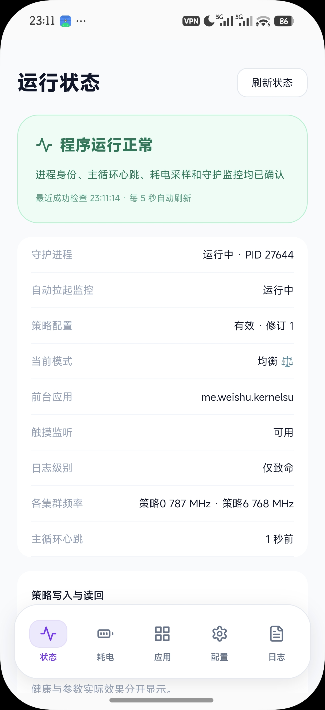
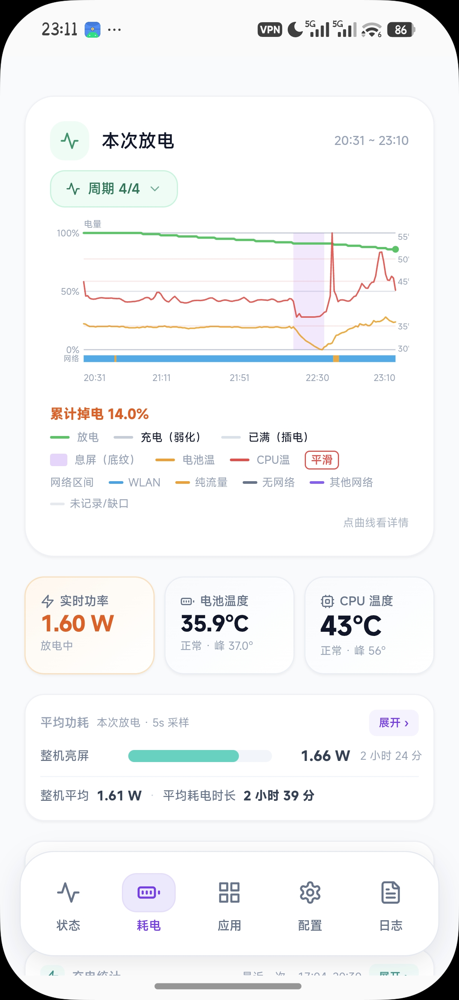
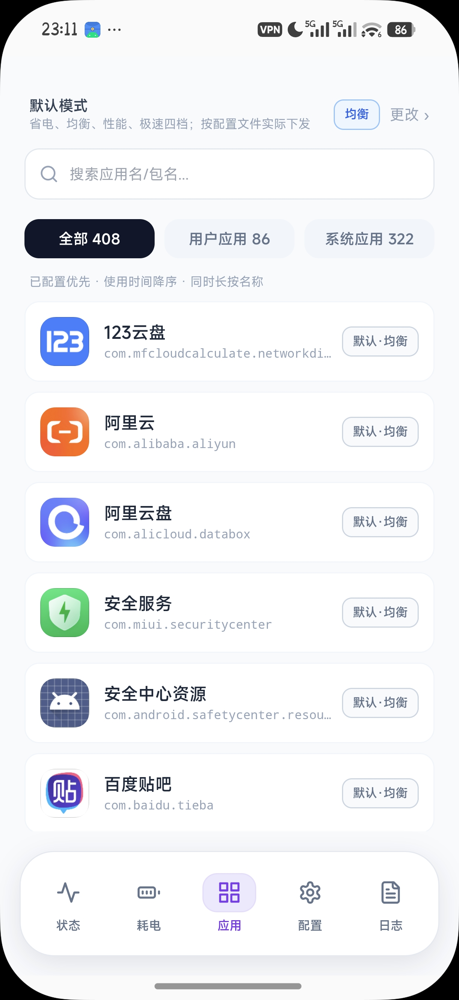
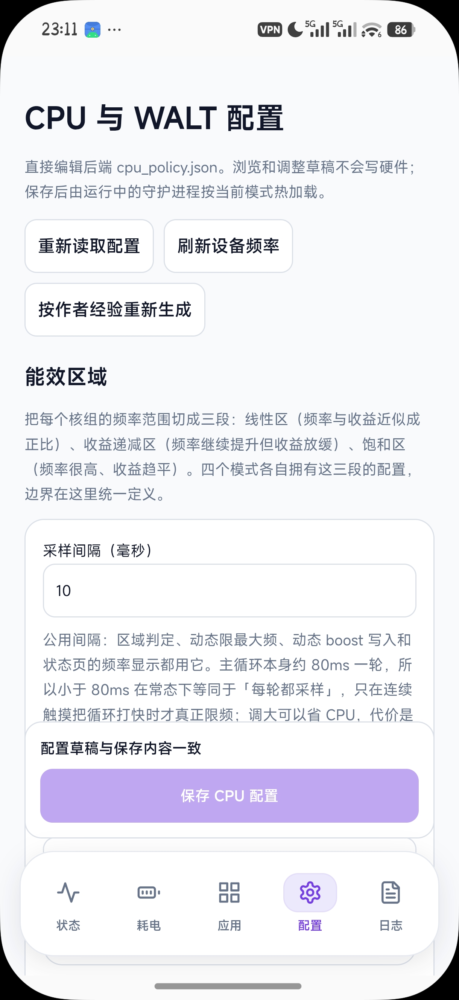

# cpupow调度（cpupow）

对澎湃 CPUWalt 调速器参数修改，根据经验配置能效（理论一加也可用）。

> 这不是「把几个参数写死」的调频模块。它先看懂手机在干什么——前台是谁、手指有没有按下去、
> CPU 此刻跑在哪一段频率——再决定这一轮该下发什么。写下去之后还会读回来核对，
> 被平台改写、被内核取整都记在账上，而不是假装一切顺利。

## 界面预览

<p align="center">
  
  
  
  
</p>
<p align="center"><sub>运行状态　·　耗电画像　·　应用分流　·　CPU 与 WALT 配置</sub></p>

## 它特别在哪

- **三段能效分区**：把每个核组的频率范围切成「线性区 / 收益递减区 / 饱和区」，
  每个区各有自己的 boost 曲线与策略树，而不是靠一个参数打天下。
- **动态限最大频**：拿两条分界线当档位上限——默认压在「线性区上界」，持续顶住够久才逐级解锁，
  一路放到硬件最高频。既不让毛刺白冲高频，也不会把正在跑的游戏死死按在低档；
  每档要顶多久，四个模式各自可调（省电最钝、极速最快）。
- **四档模式各有脾气**：省电 / 均衡 / 性能 / 极速，每档拥有独立的触摸时序与三个区域的完整配置。
- **触摸相位是状态机**：短触摸、长触摸、松手过渡、恢复基线，各有自己的增量下发与到期恢复。
- **界面是能用的**：五页 WebUI、跟随系统深色模式、耗电曲线能点到具体某一针、应用列表可搜索可分流。
- **后端很省**：事件驱动 + 写节点去重 + 空闲退避，实测活跃使用下主循环约占单核 0.76%，
  静置时会进一步降低唤醒频率。

## 功能一览

| 能力 | 说明 |
|---|---|
| 前台识别 | `dumpsys` 探测 + `/dev/cpuset/top-app` inotify，识别当前前台包名 |
| 应用分流 | 按包名指定模式（省电/均衡/性能/极速），未指定走默认 |
| 触摸感知 | BTN_TOUCH 监听，短/长触摸分阶段下发，松手有限过渡后恢复基线 |
| 频率分区 | 线性区 / 收益递减区 / 饱和区，每区独立 boost 公式（弯曲度 + 起止值） |
| 动态限最大频 | 分界线当档位上限，持续顶住才解锁；可整档关闭回到固定限频 |
| 耗电画像 | 5 秒采样、60 秒落盘，含电量/温度/功率/网络区间与应用用时排行 |
| 日志 | 分级日志、按事件类型分类、可导出前端诊断 |

## 代码分层（按数据流）

| 层 | 目录 | 职责 |
|---|---|---|
| 数据采集 | `source/collect/` | 读 sysfs、前台应用探测、触摸事件、网络状态、电池/耗电采样 |
| 数据计算 | `source/compute/` | 运行模式判定、触摸相位状态机、策略配置解析与编译、包名规则匹配 |
| 数据输出 | `source/output/` | 写 sysfs 下发调频、运行状态 JSON、分级日志 |
| 编排 | `source/app/` | 主循环，粘合采集→计算→输出，事件源装配与生命周期 |
| 公共内核 | `source/core/` | 共享状态、字符串工具、进程锁、时钟工具 |
| 第三方 | `source/deps/` | cJSON |

依赖方向：`app → collect/compute/output → core → deps`。

## 目录结构

```
.
├── source/          # C 源码（collect/compute/output 三层 + app/core/deps）
├── module/          # Magisk 模块树
│   ├── bin/         # 脚本（生命周期/看门狗/状态/电源/配置事务/CPU枚举/默认生成）
│   ├── etc/         # 数据（pkg_rules.json / powercfg.json）
│   ├── lib/         # 三 ABI cpupow 二进制
│   └── webroot/     # WebUI 前端
├── docs/screenshots/# 界面截图
├── build.py         # NDK 三 ABI 构建入口
├── Makefile         # 单 ABI 便捷构建
├── pack.py          # 模块包打包
├── ARCHITECTURE.md  # 架构与数据流说明
└── BUILD.md         # 构建与打包说明
```

## 安装

1. 在 Magisk / KernelSU / APatch 里刷入 `cpupow_sched_v1.0.0.zip`（Release 页可下载）。
2. 重启后从模块详情页打开 WebUI。
3. 首次安装会按本机频点生成作者默认配置；升级会保留你的配置、耗电数据与应用图标。

调频参数是直接写进内核节点的，不同机型/内核能接受的取值范围不完全一样。
模块会在界面里标出「读回被拒绝 / 不支持的节点」，不会静默改值——但也请自己留好回退方案。

## 快速构建

```sh
python3 build.py      # 三 ABI（arm64-v8a / armeabi-v7a / x86_64）
python3 pack.py       # 打包模块 zip
```

需要 Android NDK（默认 `/opt/android-ndk-r30`，可设 `ANDROID_NDK_HOME`）。详见 `BUILD.md`。

---

## 为爱发电

这个模块从 C 守护进程、shell 生命周期、配置解析，到 WebUI 的五个页面、每一处注释，
再到每次发版的打包与真机上一条一条啃日志——**都是一个人**在业余时间写完的。
没有团队，没有赞助，也没有广告位。

如果你觉得手机变得更省电、更跟手了，或者只是觉得这份工程做得足够讲究，
欢迎请作者喝杯水：

### ☕ [爱发电 · 支持作者](https://www.ifdian.net/a/nullcom)

> **作者的话**
>
> 因 **2026 年不幸感染「肾虚」**，目前仍在与久坐、熬夜、深夜调参三大宿敌苦战。
> 恳请各路道友慷慨解囊，资助作者救治（指买点补品、早点睡觉）。
> 你的每一份支持，都会变成下一个版本里更少的 bug、更准的调频曲线。

也欢迎不花钱的支持：点个 Star、提个 Issue 带上日志、或者把这个模块推荐给同样被调频折磨的人。